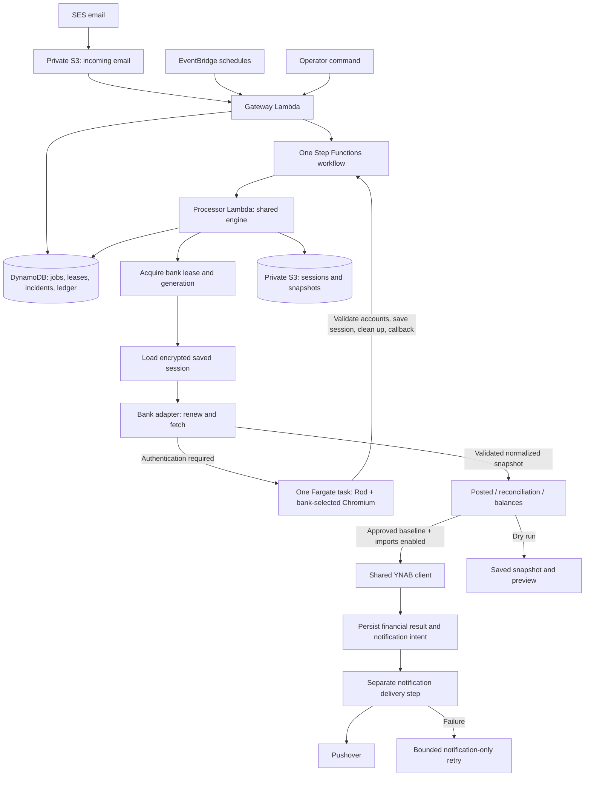

# Transactions

One Go application imports bank transactions and balances into YNAB. Bank protocols live in adapters; a shared engine owns authentication state, leases, reconciliation, writes and notification delivery.



## Repository

- `internal/bank`: adapter contract, typed failures, narrow HTTP/browser/MFA helpers.
- `internal/banks`: EQ, Rogers and NBDB adapters; registry owns schedules, browser selection and import strategy.
- `internal/engine`: one orchestration, retry, baseline, import and notification implementation.
- `internal/state`: one DynamoDB fencing and S3 persistence implementation.
- `internal/service`, `internal/email`, `internal/notify`: reused YNAB, AI, MIME and Pushover code.
- `cmd/lambda`: gateway and processor roles from the same Go binary.
- `cmd/browser`: bounded Rod authentication worker; no YNAB secret permission.
- `cmd/operator`: administrative API client; no session-reading operation.
- `cdk`: Go CDK definition for the complete runtime. No NAT gateway or always-running worker.

## Operational rules

Authentication expiry permits renewal and one browser attempt per job. Credentials and unsupported challenges pause authentication until an operator resumes it. Maintenance, throttling and temporary read failures defer through the workflow. Arbitrary 403s and malformed bank responses are review failures, not a reason to log in repeatedly.

A bank lease fences every state change with a generation. Session objects are immutable; publishing their pointer requires the current lease. Browser results are saved before callbacks and recovered if the callback is lost. Browser work has an absolute deadline shorter than the callback timeout. EQ missing-activity waits release the lease for 1, 5 and 15 minutes.

EQ four-hour imports process cleared transactions only. Purchase-alert jobs retain the pending authorization import path.

EQ authentication runs on demand during four-hour imports and purchase-alert lookups. These jobs reuse usable sessions and renew or launch browser authentication when needed; sessions may expire between jobs, so purchase alerts can take longer to resolve. There is no background EQ upkeep schedule. Explicit manual session verification remains available and has no import path. Rogers/NBDB authenticate when their scheduled retrieval needs it. Bank-enforced session limits still apply.

YNAB writes have no generic retry wrapper. Transaction creation uses stable import IDs; updates check the identified transaction after uncertain completion. An uncertain NBDB adjustment leaves an account hold that later jobs cannot bypass. Notifications have separate status and bounded delivery attempts; retrying delivery cannot import anything.

## Configuration and deployment

The one configuration document is `/transactions-engine/settings`. All runtime credentials live in one Secrets Manager secret, `Transactions`, created outside the stack and passed to CDK as the `secretArn` context. Its JSON holds the application keys (`YNAB_ACCESS_TOKEN`, `OPENAI_API_KEY`, `PUSHOVER_TOKEN`, `PUSHOVER_USER`), `CLOAKBROWSER_LICENSE_KEY`, `BROWSER_BROKER_TOKEN` and `BANKS` (one `{username, password, mailToken}` per bank ID). The Lambdas and the browser task can both read it. Do not put tokens in CDK context, workflow payloads, Git or logs. S3 objects are private and encrypted.

The committed CDK context records this production deployment with schedules active. For a fresh installation or a deliberate schedule pause, synthesize/deploy with `-c activate=false`; the initial settings placeholder always has imports disabled. Complete configuration and baseline review before enabling imports.

`cdk/cdk.go` is the whole stack, including the three bank schedules. There are no CloudWatch alarms; the application reports failures through Pushover.

Use the [local verification loop](docs/local-verification.md) to fix authentication and exercise real API calls without redeploying.

See [cutover and verification](docs/cutover.md) and [adding a bank](docs/adding-a-bank.md). Do not enable production imports until the real-account verification and reviewed baseline gates have passed.

## Build and inspect

The repository has no tests. CI runs static checks and builds on pull requests and pushes to `main`: `golangci-lint` (with the `gofumpt` and `goimports` formatters), `govulncheck`, `go mod tidy -diff`, `go fix -diff`, `go vet`, `go build` and `cdk synth`, for the root module and the `cdk` module. Release evidence is the `cmd/evaluate` replay and live dry runs through the [local verification loop](docs/local-verification.md).

The `cdk` module is separate and does not import the application, so no `go.work` is needed; delete any local one, or keep `GOWORK=off` set. The CDK app builds from `cdk/`, runs from the repository root, and compiles the Lambda binary itself.

```sh
export GOWORK=off
go build ./... && go vet ./... && golangci-lint run && govulncheck ./... && go mod tidy -diff && go fix -diff ./...
(cd cdk && go build ./... && go vet ./... && golangci-lint run && govulncheck ./... && go mod tidy -diff && go fix -diff ./...)
npx --yes aws-cdk@2.1144.0 synth --output dist/cdk
docker build --platform linux/arm64 --secret id=cloak_license,src="$HOME/.cloakbrowser/license.key" -t transactions-engine-browser:verify .
```

Production releases use committed, pushed `main` source. From a clean `main`
checkout, `python3 scripts/deploy-main.py diff` shows what CDK would change.
`python3 scripts/deploy-main.py deploy` shows the same diff, asks for
confirmation and runs `cdk deploy`, which builds both Lambda packages and the
browser image (from its pinned base, with the CloakBrowser licence file as a
build secret). Docker must be running. The script refuses another branch,
uncommitted changes, or a revision that is not the remote `main` head.

## Shared browser capacity

Hermes, Rogers and NBDB share CloakBrowser capacity through the Go
[browser broker](docs/browser-broker.md). Hermes launches its persistent browser
on demand; bank authentication immediately reserves exclusive access. The
public HTTPS control API requires a bearer token, while CDP stays private.
